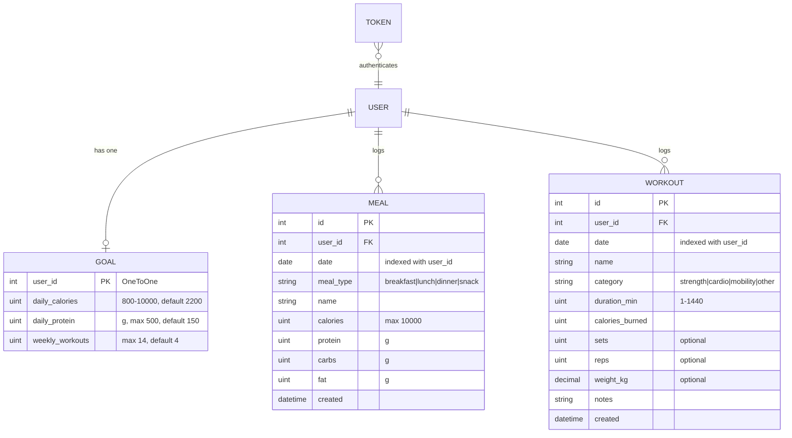

# KILO — Backend Design

KILO is a calorie and workout tracker. The backend is a Django 6 application with a
server-rendered web UI and a JSON REST API that share one data model and one business-logic layer.

## 1. Architecture

```
 Browser (HTML pages) ──┐                       ┌── views.py   (HTML, session auth)
                        ├──►  urls.py  ──►──────┤
 API clients (JSON) ────┘                       └── api.py     (DRF, token/session auth)
                                                       │
                                                       ▼
                                          services.py  (all calculations)
                                                       │
                                                       ▼
                                   models.py  ──►  SQLite (Postgres-ready)
```

| Layer | File | Responsibility |
|---|---|---|
| Routing | `myapp/urls.py` | Web, auth and `/api/` routes |
| Web views | `myapp/views.py` | Login-protected pages, form handling |
| API | `myapp/api.py`, `myapp/serializers.py` | Validation + JSON for every resource |
| Business logic | `myapp/services.py` | Totals, net calories, progress, 7-day series |
| Data | `myapp/models.py` | Schema, constraints, indexes |
| Admin | `myapp/admin.py` | Back-office browsing and search |
| Tests | `myapp/tests.py` | 15 tests: services, web, API, data isolation |

Views and API endpoints stay thin. Every number the user sees comes from `services.py`, so the
dashboard and `/api/summary/` can never disagree.

## 2. Data model



Design decisions:

- **Ownership on every row.** `Meal` and `Workout` carry `user` (`CASCADE`), so deleting an account removes its data.
- **Composite index `(user, date)`** on both log tables — every query is "this user, this day or range".
- **Validation lives in the model** (`MinValueValidator` / `MaxValueValidator`, unsigned fields), so forms, the API and the admin all enforce the same limits.
- **`Goal` is created lazily** with `Goal.for_user()`, so signup needs no extra step.
- **Derived values are not stored.** Totals, net calories and volume (`sets × reps × weight`) are computed, never duplicated.
- **Time zone:** `Asia/Kolkata`, `USE_TZ = True`. "Today" is `timezone.localdate()`.

## 3. Authentication and authorisation

| Client | Mechanism |
|---|---|
| Web UI | Django sessions, CSRF on every POST, `@login_required` |
| API | `Authorization: Token <key>` (or the session cookie) |

- Passwords go through Django's validators (length, common-password and similarity checks), including on `/api/auth/register/`.
- **Row-level scoping:** every queryset is filtered by `request.user`. Another user's object returns **404**, not 403, so IDs can't be probed.
- `user` is never accepted from a client: the server stamps it in `perform_create` / `form.save(commit=False)`.
- `/api/auth/register/` and `/api/auth/token/` are throttled to 20 requests/min per IP.
- Deleting is POST-only on the web side.

## 4. REST API

Base path `/api/`. JSON only. All endpoints except the two auth ones require authentication.
Lists are paginated (`PAGE_SIZE = 50`: `count`, `next`, `previous`, `results`).

| Method | Path | Purpose |
|---|---|---|
| POST | `/api/auth/register/` | Create account → `{username, token}` |
| POST | `/api/auth/token/` | Exchange username/password for a token |
| GET, POST | `/api/meals/` | List / create meals |
| GET, PUT, PATCH, DELETE | `/api/meals/{id}/` | Read / update / delete one meal |
| GET, POST | `/api/workouts/` | List / create workouts |
| GET, PUT, PATCH, DELETE | `/api/workouts/{id}/` | Read / update / delete one workout |
| GET, PUT, PATCH | `/api/goal/` | Read / update daily targets |
| GET | `/api/summary/` | Dashboard data for a day plus the last 7 days |

Filters on `/api/meals/` and `/api/workouts/`: `?date=YYYY-MM-DD`, `?from=…`, `?to=…`.
A malformed date returns `400 {"date": "Use YYYY-MM-DD."}`.

Error shape follows DRF: `400` field errors as `{"field": ["message"]}`, `401` unauthenticated, `404` not found or not yours.

### Example session

```bash
# 1. Register (returns a token)
curl -X POST http://127.0.0.1:8000/api/auth/register/ \
     -H "Content-Type: application/json" \
     -d '{"username":"ana","password":"Str0ng-pass-99"}'

# 2. Log a meal
curl -X POST http://127.0.0.1:8000/api/meals/ \
     -H "Authorization: Token <key>" -H "Content-Type: application/json" \
     -d '{"name":"Chicken rice bowl","meal_type":"lunch","calories":680,"protein":48,"carbs":75,"fat":18}'

# 3. Today's summary
curl http://127.0.0.1:8000/api/summary/ -H "Authorization: Token <key>"
```

`/api/summary/` response (abridged):

```json
{
  "date": "2026-10-27",
  "goal": {"daily_calories": 2200, "daily_protein": 150, "weekly_workouts": 4},
  "totals": {"calories": 1100, "protein": 66, "carbs": 145, "fat": 27, "burned": 320, "minutes": 45},
  "net_calories": 780,
  "remaining_calories": 1420,
  "over_goal": false,
  "calorie_progress_pct": 50,
  "protein_progress_pct": 44,
  "sessions_this_week": 1,
  "week": [{"date": "2026-10-21", "eaten": 0, "burned": 0}, "..."]
}
```

## 5. Business rules (`services.py`)

- `net = eaten − burned`; `remaining = goal − net`; `over = net > goal`.
- Calorie ring shows **eaten ÷ goal**, capped at 100 %.
- A "session" is a distinct *day* with at least one workout, counted from Monday of the current week.
- The 7-day series ends on the requested day; bar heights are scaled to the largest of goal / eaten / burned.

## 6. Running and testing

```bash
python manage.py migrate
python manage.py createsuperuser     # optional: /admin/
python manage.py runserver
python manage.py test                # 15 tests
```

## 7. Known limits and next steps

- **Production hardening:** `SECRET_KEY` and `DEBUG` are still the development defaults. Move them to environment variables and set `ALLOWED_HOSTS` before deploying.
- **Database:** SQLite is fine for one machine. Switch `DATABASES` to PostgreSQL for multi-user hosting; no model changes are needed.
- **Food database:** meals are free-text entries. A `Food` table with per-100 g macros would let users pick items instead of typing numbers.
- **Exercise sets:** a workout holds one set/rep/weight triple. A `WorkoutSet` child table would model multi-exercise sessions.
- **Token lifecycle:** DRF tokens don't expire. Add expiry or JWT if the API is exposed publicly.
